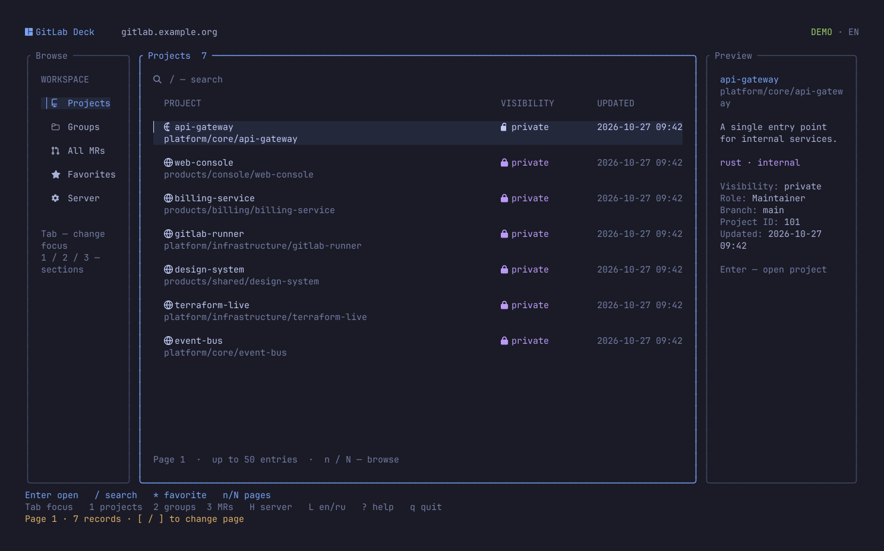
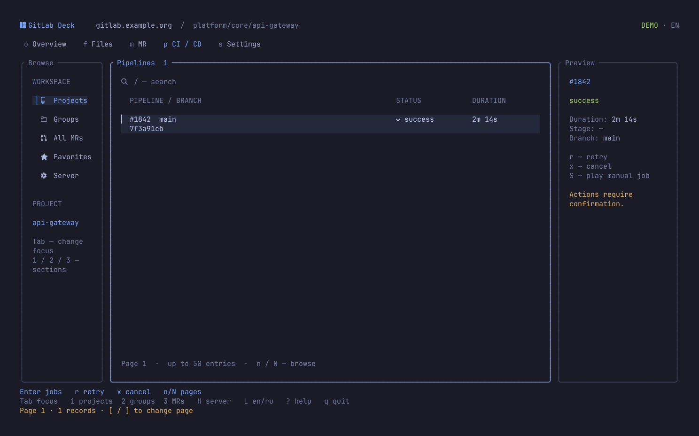
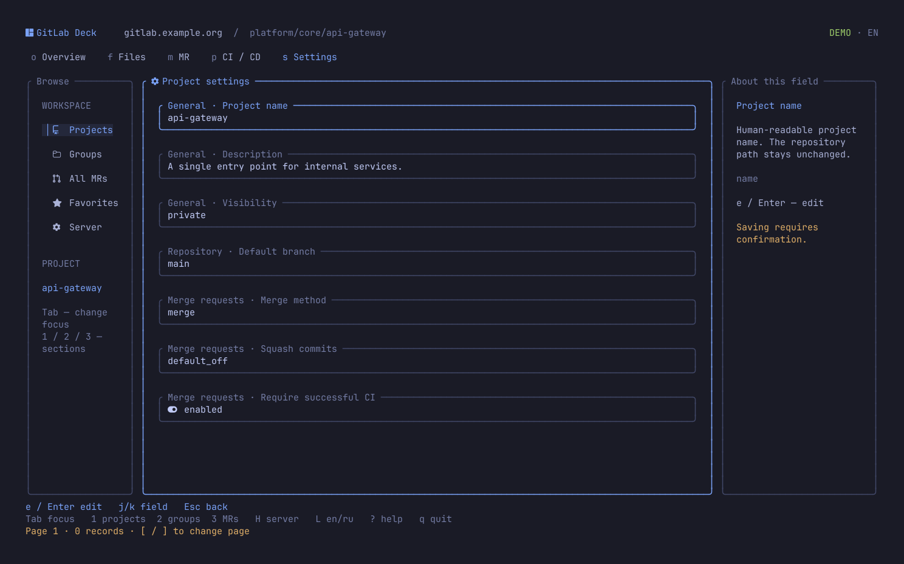

<div align="center">

# GitLab Deck

**English** · [Русский](README.ru.md)

### GitLab, in your terminal.

Projects · code · merge requests · CI/CD


[Install](#install) · [Quick start](#quick-start) · [Language](#interface-language) · [Keys](#keys) · [Features and limits](#features-and-limits)

</div>



**Find a project, review an MR, and follow a pipeline down to its job log — all from your terminal.**
GitLab Deck is a standalone Rust TUI client for GitLab.com and self-managed GitLab servers. No local checkout required. Sign in with the `glab` you already use.

## What's inside

| Area | Features |
|:---|:---|
| **Projects and groups** | Available projects, group projects, search, pagination, and local favorites |
| **Repository** | Browse directories, text files, and branches without cloning |
| **Merge requests** | Open MRs, descriptions, diffs, comments, and text search |
| **CI/CD** | Pipelines → jobs → logs; retry, cancel, and start manual jobs |
| **Settings** | Edit project settings with input validation and a confirmation for each change |
| **Terminal** | Tokyo Night, Nerd Font icons, rounded panels, padding, and a clear focus indicator |

<details>
<summary><strong>Explore CI/CD</strong></summary>



`p` → select a pipeline → `Enter` → select a job → `Enter` → read its log.

</details>

<details>
<summary><strong>Explore project settings</strong></summary>



`e` → edit a field → check the old and new values → confirm or press `Esc`.

</details>

*Screenshots show demo data rendered by the application.*

## Install

You need **Linux**, a current stable **Rust** toolchain, Git, and [GitLab CLI (`glab`)](https://docs.gitlab.com/cli/).

```sh
cargo install --git https://github.com/IgorKramar/gitlab-deck --locked
```

Cargo installs the `gitlab-deck` binary in its `bin` directory, usually `~/.cargo/bin`. Make sure it is in your `PATH`.

<details>
<summary>Build from source</summary>

```sh
git clone https://github.com/IgorKramar/gitlab-deck.git
cd gitlab-deck
cargo install --path . --locked
```

</details>

For the look shown above, use a true-color terminal and a [Nerd Font](https://www.nerdfonts.com/). The minimum size is **80 × 24**; use `Tab` to switch panels in narrow windows.

## Quick start

### Try it first

```sh
gitlab-deck --demo --lang en
```

Demo mode needs no network or credentials. Browse screens, edit settings, and start manual jobs. Demo changes last until you exit; your settings file stays unchanged.

### Connect to GitLab

```sh
glab auth login --hostname gitlab.example.org
gitlab-deck --host gitlab.example.org
```

For GitLab.com, use `--hostname gitlab.com` and `--host gitlab.com`. If `glab` is already authenticated with your server, just run the second command.

The server is remembered, so subsequent launches only need:

```sh
gitlab-deck
```

Check the connection without opening the TUI:

```sh
gitlab-deck --check
```

## Interface language

English and Russian are available:

```sh
gitlab-deck --demo --lang en
gitlab-deck --lang ru
```

Press `L` to switch between EN/RU in the TUI. Normal mode saves your choice; demo mode leaves your settings unchanged.

Language priority is `--lang` → saved language → system locale → English. Locale detection uses the first non-empty value of `LC_ALL`, `LC_MESSAGES`, and `LANG`: a `ru` locale selects Russian; other locales select English.

Only application labels change. GitLab project names, comments, diffs, and logs keep their original content. Demo data is initialized in the language selected at startup. Command-line help remains in English.

## Keys

| Keys | Action |
|:---|:---|
| `j` / `k`, `↑` / `↓`, `PgUp` / `PgDn` | Select a row or scroll |
| `←` / `→` in text | Scroll long lines horizontally |
| `Tab` / `Shift+Tab` | Focus the sidebar, content, or details |
| `Enter` / `Esc` | Open / go back |
| `1` / `2` / `3` | Projects / groups / all open MRs |
| `o` / `f` / `b` | Project overview / files / branches |
| `m` / `p` / `s` | MRs / CI/CD / settings |
| `d` / `c` inside an MR | Diff / comments |
| `/` | Search; exact branch filter for pipelines |
| `[` / `]` | Previous / next API page |
| `n` / `N` in text | Next / previous match |
| `*` | Add or remove a favorite project |
| `R` / `F5` | Refresh data, including the current log |
| `r` / `x` / `S` | Retry CI / cancel CI / start a manual job |
| `e` in settings | Edit a field; `←/→` select a value, `Ctrl+U` clears input |
| `H` | Switch servers |
| `L` | Switch EN/RU |
| `?` / `q` | Help / quit |

`q` closes an open dialog first. `Ctrl+C` exits the application.

## Features and limits

**Changes need confirmation.** A settings change shows the project, field, and old and new values. A CI action shows the project, resource, and command. Press `Esc` to cancel. Editing settings requires the Maintainer or Owner role; GitLab makes the final permissions check.

<details>
<summary>Available settings</summary>

- Project name, description, visibility, and default branch.
- Merge method and squash policy.
- Successful pipeline and resolved discussion requirements.
- Source branch deletion after merging.
- Access to issues, merge requests, wiki, and CI/CD.
- Shared runners and job timeout.

Only the selected field is changed. If the server does not return a field, the editor does not invent a value.

</details>

**Lists use pages of 50 records.** Files, jobs, and favorites are filtered on the current page. Use `[` / `]` to page through diffs and comments as well. Refresh logs manually with `R` / `F5`.

**Responses are limited to 2 MiB.** Oversized JSON is rejected; truncated text is clearly marked. GitLab may impose additional diff limits. Binary files are not displayed.

**Current limits.** GitHub, instance administration, user and group management, CI secrets, posting comments, and merging MRs are not supported. IPv6 server addresses are not supported.

## Credentials and local settings

`glab` handles authentication. GitLab Deck does not create its own token store or pass tokens in process arguments. Terminal control sequences are removed from responses and logs before rendering.

The server, favorites, and interface language are stored in:

```text
$XDG_CONFIG_HOME/gitlab-deck/config.json
# or ~/.config/gitlab-deck/config.json
```

Server priority is `--host` → saved setting → `GITLAB_HOST` → `gitlab.com`. Use `hostname[:port]`, without a scheme or path.

> If a connection fails during a change request, the outcome may be unknown. The application reloads data and displays a warning. Verify the result before retrying: exiting the TUI does not cancel an operation already sent to the server.

## Development

The interface uses [Ratatui](https://ratatui.rs/) and Crossterm; the transport uses `glab api`. One background worker handles requests, and request IDs prevent stale responses from replacing the current screen. See the [architecture decision](docs/adr/0001-terminal-and-authentication.md).

```sh
cargo fmt --check
cargo clippy --all-targets -- -D warnings
cargo test --locked
cargo build --release --locked
python3 tests/terminal_smoke.py target/release/gitlab-deck
```

Tests use demo mode and a fake CLI. The PTY check covers navigation and terminal restoration at three sizes. These checks do not change real GitLab data.

Found a bug? [Open an issue](https://github.com/IgorKramar/gitlab-deck/issues) with the application version, terminal size, and reproduction steps. Leave private addresses, project contents, and tokens out of the report.

---

<div align="center">

**[Igor Kramar](https://github.com/IgorKramar)** · Rust · Tokyo Night

</div>
