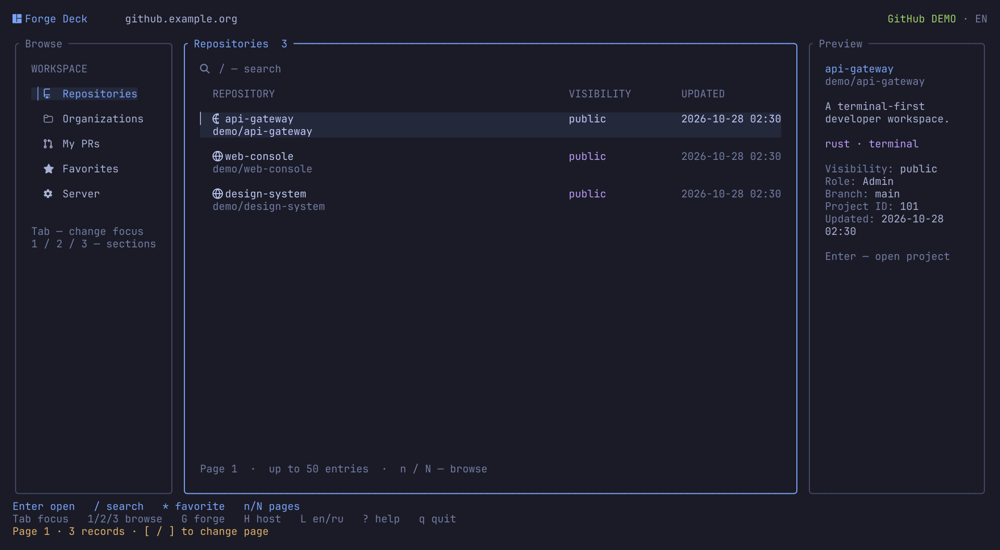
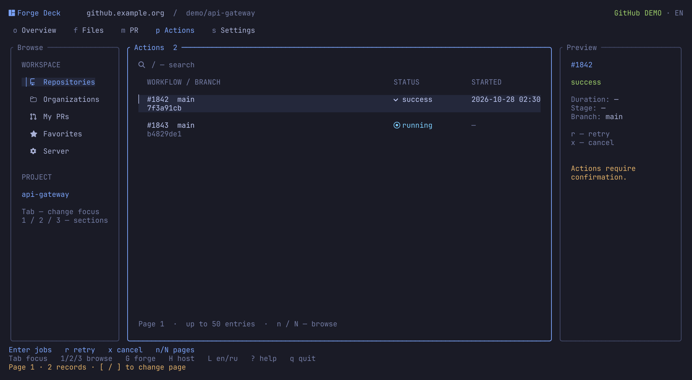
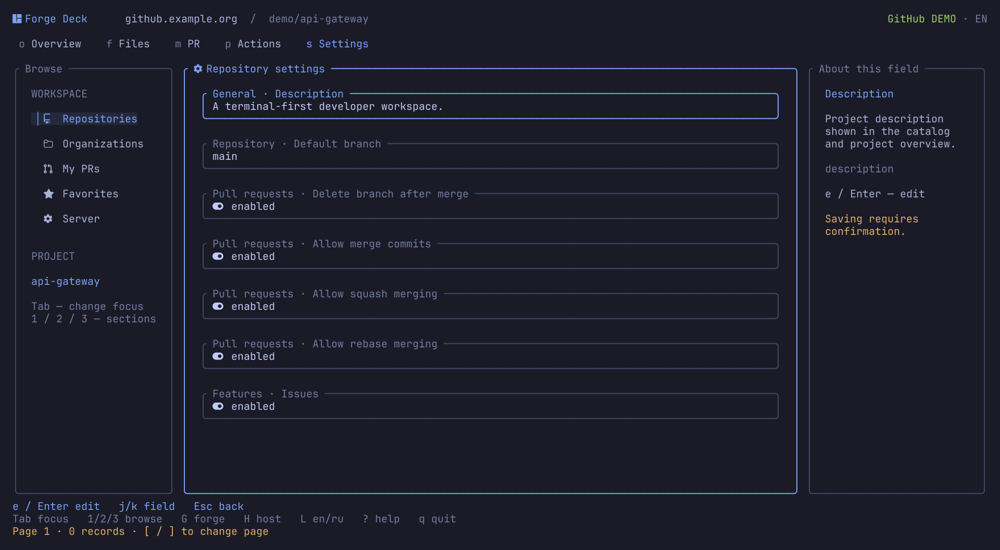

<div align="center">

# Forge Deck

**English** · [Русский](README.ru.md)

### GitHub & GitLab. One terminal workspace.

Repositories · pull & merge requests · Actions & pipelines

[](https://github.com/IgorKramar/forge-deck/actions/workflows/ci.yml)
[](https://github.com/IgorKramar/forge-deck/releases/latest)
[](LICENSE)


[Install](#install) · [Quick start](#quick-start) · [Language](#interface-language) · [Keys](#keys) · [Limits](#features-and-limits)

</div>



**Find a repository, review a change, and follow CI down to its job log — all from your terminal.**
Forge Deck is a standalone Rust TUI for GitHub, GitHub Enterprise, GitLab.com, and self-managed GitLab. No local checkout required. Authentication stays with the `gh` and `glab` you already use.

Tokyo Night colors, Nerd Font icons, rounded panels, room to breathe, and a clear focus indicator. Press **`G`** to switch platforms; your server and favorites are remembered separately.

## What's inside

| Area | GitHub | GitLab |
|:---|:---|:---|
| **Browse** | Accessible repositories, organizations, repository search | Projects, groups, group projects, search |
| **Code** | Directories, text files, branches | Directories, text files, branches |
| **Review** | Open PRs, descriptions, file patches, general PR comments; global PRs involving you | Open MRs, descriptions, diffs, comments; global MR list |
| **CI** | Actions runs → jobs → logs; rerun a run or job, cancel a run | Pipelines → jobs → logs; retry, cancel, start manual jobs |
| **Settings** | Eight repository settings, administrator access required | Fifteen project settings, Maintainer/Owner required |
| **Workspace** | Local favorites, paging, EN/RU | Local favorites, paging, EN/RU |

<details>
<summary><strong>Follow GitHub Actions</strong></summary>



`p` → select a run → `Enter` → select a job → `Enter` → read its log.

Rerunning a GitHub job also reruns its dependent jobs. GitHub cancellation applies to the whole workflow run; individual job cancellation and GitLab-style manual jobs are unavailable.

</details>

<details>
<summary><strong>Keep GitLab close</strong></summary>


The same navigation, native GitLab actions. `G` switches back to your saved GitLab connection.

</details>

<details>
<summary><strong>Change a setting deliberately</strong></summary>



`e` → edit one field → inspect the old and new values → confirm or press `Esc`.

</details>

*Screenshots show demo data rendered by the application.*

## Install

You need **Linux** and the CLI for the platform you use: [GitHub CLI (`gh`)](https://cli.github.com/) and/or [GitLab CLI (`glab`)](https://docs.gitlab.com/cli/). Try `--demo` without either CLI or credentials.

### Prebuilt binary

[Releases](https://github.com/IgorKramar/forge-deck/releases/latest) include **x86_64** and **ARM64** Linux archives, built on Ubuntu 22.04 with glibc. They are not musl/Alpine binaries. No Rust toolchain is needed.

```sh
version=0.3.0
target=x86_64-unknown-linux-gnu  # ARM64: aarch64-unknown-linux-gnu
archive="forge-deck-v$version-$target.tar.gz"
base="https://github.com/IgorKramar/forge-deck/releases/download/v$version"
curl --fail --location --remote-name "$base/$archive" --remote-name "$base/SHA256SUMS" &&
awk -v archive="$archive" '$2 == archive' SHA256SUMS | sha256sum --check - &&
tar -xzf "$archive" &&
install -Dm755 "forge-deck-v$version-$target/forge-deck" "$HOME/.local/bin/forge-deck" &&
install -Dm755 "forge-deck-v$version-$target/gitlab-deck" "$HOME/.local/bin/gitlab-deck"
```

Keep `~/.local/bin` in your `PATH`. The archive includes both commands, both READMEs, the MIT license, changelog, design notes, screenshots, and `BUILDINFO.json` with the source commit and target.

### Build with Cargo

You need Git and a current stable Rust toolchain supporting edition 2024.

```sh
cargo install --git https://github.com/IgorKramar/forge-deck --tag v0.3.0 --locked
```

Cargo installs `forge-deck` and the compatible `gitlab-deck` command, usually in `~/.cargo/bin`. Keep that directory in your `PATH`.

<details>
<summary>Build from a local checkout</summary>

```sh
git clone https://github.com/IgorKramar/forge-deck.git
cd forge-deck
cargo install --path . --locked
```

</details>

Use a true-color terminal and a [Nerd Font](https://www.nerdfonts.com/) for the look above. Minimum size: **80 × 24**. In narrow windows, `Tab` brings the sidebar or preview into focus.

## Quick start

### Try either platform offline

```sh
forge-deck --demo --provider github --lang en
forge-deck --demo --provider gitlab --lang en
```

Demo mode needs no network or credentials and leaves your settings file unchanged. Changes live in memory; reconnecting or switching platforms resets demo data.

### GitHub

```sh
gh auth login --hostname github.com
forge-deck --provider github
```

For GitHub Enterprise, authenticate with its hostname and pass it with `--host`:

```sh
gh auth login --hostname github.example.org
forge-deck --provider github --host github.example.org
```

### GitLab

```sh
glab auth login --hostname gitlab.example.org
forge-deck --provider gitlab --host gitlab.example.org
```

Use `gitlab.com` for GitLab.com. If the CLI is already authenticated, skip its login command.

Subsequent launches restore the selected platform and its server:

```sh
forge-deck
```

Press `G` to switch between GitHub and GitLab, or `H` to change the current platform's server. Check a connection without opening the TUI:

```sh
forge-deck --provider github --check
forge-deck --provider gitlab --check
```

### Upgrading from GitLab Deck

The project was renamed to **Forge Deck** in 0.3.0. The `gitlab-deck` command still works. If no new settings file exists, Forge Deck reads your old GitLab Deck settings, retaining language, server, favorites, and unknown fields. The original file is left unchanged; normal mode saves to the new path.

## Interface language

```sh
forge-deck --lang en
forge-deck --lang ru
```

`L` switches EN/RU, refreshes the screen, and saves your choice in normal mode. Demo mode does not save preferences.

Priority: `--lang` → saved language → system locale → English. Locale detection uses the first non-empty `LC_ALL`, `LC_MESSAGES`, or `LANG`: `ru` selects Russian; other locales select English.

Application labels are translated. Repository contents, comments, diffs, and logs keep their original text. Demo content uses the language selected at startup. Command-line help is in English.

## Keys

| Keys | Action |
|:---|:---|
| `j` / `k`, `↑` / `↓`, `PgUp` / `PgDn` | Select a row or scroll |
| `←` / `→` in text | Scroll horizontally |
| `Tab` / `Shift+Tab` | Focus sidebar / content / preview |
| `Enter` / `Esc` | Open / go back |
| `1` / `2` / `3` | Repositories / organizations / involved PRs on GitHub; projects / groups / MRs on GitLab |
| `o` / `f` / `b` | Overview / files / branches |
| `m` / `p` / `s` | PRs or MRs / CI / settings |
| `d` / `c` in a PR or MR | Diff / comments |
| `/` | Search; exact branch filter for CI runs |
| `[` / `]` | Previous / next page |
| `n` / `N` in text | Next / previous match |
| `*` | Add or remove a favorite |
| `R` / `F5` | Refresh the current screen or log |
| `r` / `x` | Rerun / cancel CI, where supported |
| `S` | Start a manual GitLab job |
| `e` in settings | Edit a field; `←/→` choose a value, `Ctrl+U` clears input |
| `G` / `H` | Switch platform / change server |
| `L` | Switch EN/RU |
| `?` / `q` | Help / quit |

`q` closes an open dialog first. `Ctrl+C` exits.

## Features and limits

**Changes need confirmation.** Settings show the field and old/new values; CI actions show the repository, resource, and action. Only one field is written at a time. Unavailable fields cannot be edited. The server makes the final permission check.

<details>
<summary>Available settings</summary>

**GitHub:** description, default branch, deletion of branches after merging, merge commits, squash merging, rebase merging, issues, and wiki. Requires repository admin permissions and a token with the corresponding access.

**GitLab:** project name, description, visibility, default branch, merge method, squash policy, successful CI and resolved discussion requirements, source branch deletion, access levels for issues/MRs/wiki/CI, shared runners, and job timeout.

</details>

**Lists use pages of 50 records.** Files, jobs, and favorites are filtered on the current page; GitHub organizations and branches also use page-local filtering. GitHub repository search searches accessible GitHub repositories rather than only the loaded catalog. The global PR list uses `involves:you`; it is not a list of every PR you can access.

**GitHub API limits apply.** Search exposes at most 1,000 results. Directory contents are paged locally from the Contents response, which is limited to 1,000 entries. PR file lists have a 3,000-file limit; some patches are omitted by GitHub. The comments screen shows general PR conversation, not inline review comments or review submissions. Job logs may be unavailable until the job completes. Refresh manually with `R` / `F5`.

**Responses are limited to 2 MiB.** Oversized JSON is rejected; truncated text is marked. Binary files and GitHub submodule/symlink entries are not previewed. GitLab may impose additional diff limits.

**Current limits.** No instance administration, organization/group/user management, CI secret editing, comment posting, or PR/MR merging. IPv6 server addresses are unsupported. GitHub favorites resolve numeric repository IDs through the currently available, undocumented `repositories/{id}` route.

## Credentials and local settings

`gh` and `glab` own authentication. Forge Deck does not read their token files, create a token store, or pass tokens in process arguments. Terminal control sequences are removed from responses before rendering.

Preferences live in:

```text
$XDG_CONFIG_HOME/forge-deck/config.json
# or ~/.config/forge-deck/config.json
```

The old `gitlab-deck/config.json` is read only when the new file is absent. Platform priority is `--provider` → saved platform → GitLab. Server priority is `--host` → saved server for that platform → `GH_HOST` / `GITLAB_HOST` → `github.com` / `gitlab.com`. Use `hostname[:port]`, without a scheme or path. Favorites are scoped to both platform and server.

> If a connection fails during a change, its outcome may be unknown. The app reloads data and keeps a warning. Verify the result before retrying: exiting does not cancel a server operation already sent.

## Development

[Ratatui](https://ratatui.rs/) and Crossterm render the UI; `gh api` / `glab api` handle REST transport. One background worker handles requests, with cancellation, timeouts, and generation IDs to reject stale results. See [authentication and terminal design](docs/adr/0001-terminal-and-authentication.md) and [GitHub integration](docs/adr/0002-multiple-forges.md).

```sh
cargo fmt --all -- --check
cargo clippy --locked --all-targets -- -D warnings
cargo test --locked
cargo build --release --locked
python3 tests/terminal_smoke.py target/release/forge-deck
python3 tests/provider_hosts.py target/release/forge-deck
python3 -m unittest discover -s tests -p test_release.py
```

Tests use demo data and a fake CLI. PTY checks cover both platforms and languages at three terminal sizes. These checks do not change real repositories.

CI runs formatting, Clippy, Rust tests, archive validation, and smoke checks against the extracted binaries on native Linux x86_64 and ARM64 runners. Pushing a `v*` tag reruns these checks, verifies the Cargo version and source commit, then publishes both archives and `SHA256SUMS`. Release notes live in `docs/releases/`; see the [changelog](CHANGELOG.md).

If publishing fails, the draft is kept for inspection. Review the failed run and its draft, delete only that failed draft while keeping the Git tag, then rerun the workflow; published releases are never overwritten automatically.

For a pull request, explain the behavior change, update both interface languages and READMEs where needed, and run the checks above.

Found a bug? [Open an issue](https://github.com/IgorKramar/forge-deck/issues) with the version, terminal size, and reproduction steps. Keep private addresses, repository contents, and tokens out of reports.

## License

[MIT](LICENSE) · Copyright © 2026 Igor Kramar.

---

<div align="center">

**[Igor Kramar](https://github.com/IgorKramar)** · Rust · Tokyo Night

</div>
