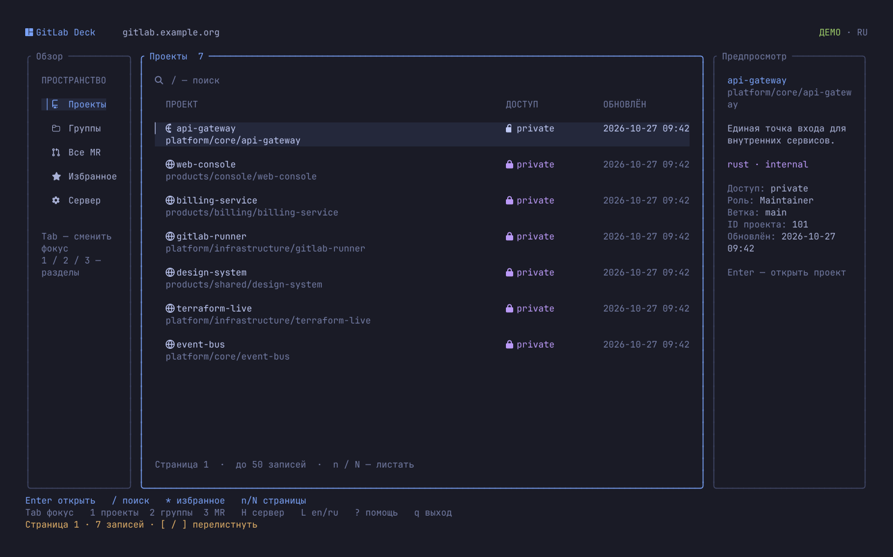
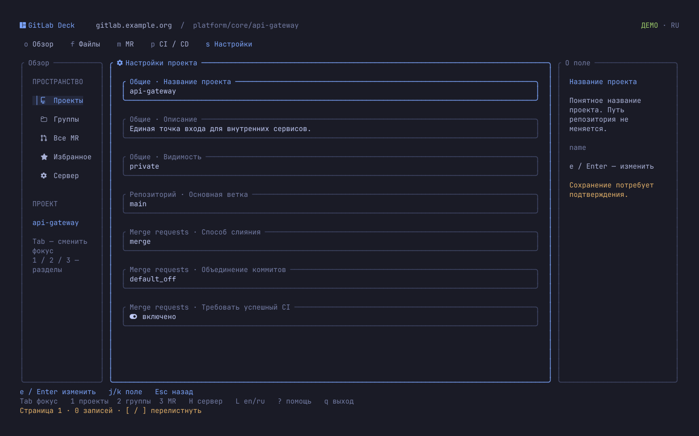

<div align="center">

# GitLab Deck

[English](README.md) · **Русский**

### GitLab, который живёт в терминале.

Проекты · код · merge requests · CI/CD


[Установка](#установка) · [Быстрый старт](#быстрый-старт) · [Язык](#язык-интерфейса) · [Клавиши](#клавиши) · [Возможности и границы](#возможности-и-границы)

</div>



**Найди проект, посмотри MR, дойди от пайплайна до лога — оставаясь в терминале.**
GitLab Deck — самостоятельный TUI-клиент на Rust для GitLab.com и собственных GitLab-серверов. Проекты не нужно клонировать. Для входа используется уже знакомый `glab`.

## Что внутри

| Раздел | Возможности |
|:---|:---|
| **Проекты и группы** | Каталог доступных проектов, проекты группы, поиск, страницы, локальное избранное |
| **Репозиторий** | Каталоги, текстовые файлы и ветки без локального checkout |
| **Merge requests** | Открытые MR, описание, диффы и комментарии, поиск по тексту |
| **CI/CD** | Пайплайны → джобы → логи, повтор и отмена, запуск ручных джоб |
| **Настройки** | Параметры проекта с проверкой ввода и подтверждением каждого изменения |
| **Терминал** | Tokyo Night, иконки Nerd Font, скруглённые панели, отступы и заметный фокус |

<details>
<summary><strong>Посмотреть CI/CD</strong></summary>


`p` → выбрать пайплайн → `Enter` → выбрать джобу → `Enter` → читать лог.

</details>

<details>
<summary><strong>Посмотреть настройки проекта</strong></summary>



`e` → изменить поле → проверить прежнее и новое значения → подтвердить или нажать `Esc`.

</details>

*На снимках — демонстрационные данные из фактического рендера приложения.*

## Установка

Нужны **Linux**, актуальный стабильный **Rust**, Git и [GitLab CLI (`glab`)](https://docs.gitlab.com/cli/).

```sh
cargo install --git https://github.com/IgorKramar/gitlab-deck --locked
```

Cargo устанавливает бинарник `gitlab-deck` в свой каталог `bin` — обычно `~/.cargo/bin`. Он должен быть в `PATH`.

<details>
<summary>Собрать из исходников</summary>

```sh
git clone https://github.com/IgorKramar/gitlab-deck.git
cd gitlab-deck
cargo install --path . --locked
```

</details>

Для оформления как на скриншотах: терминал с true color и [Nerd Font](https://www.nerdfonts.com/). Минимальный размер — **80 × 24**; в узком окне панели переключаются через `Tab`.

## Быстрый старт

### Сначала посмотреть

```sh
gitlab-deck --demo --lang ru
```

Демо работает без сети и учётных данных. Можно переходить по экранам, менять настройки и запускать ручные джобы. Все демонстрационные изменения исчезнут после выхода; пользовательский config не меняется.

### Подключить свой GitLab

```sh
glab auth login --hostname gitlab.example.org
gitlab-deck --host gitlab.example.org
```

Для GitLab.com используй `--hostname gitlab.com` и `--host gitlab.com`. Если `glab` уже авторизован на нужном сервере, достаточно второй команды.

Сервер запоминается, поэтому дальше можно запускать просто:

```sh
gitlab-deck
```

Проверить подключение без открытия TUI:

```sh
gitlab-deck --check
```

## Язык интерфейса

Доступны английский и русский:

```sh
gitlab-deck --demo --lang en
gitlab-deck --lang ru
```

`L` переключает EN/RU внутри TUI и обновляет текущий экран. В обычном режиме выбор сохраняется; деморежим не меняет пользовательские настройки.

Приоритет: `--lang` → сохранённый язык → системная локаль → английский. Для локали берётся первое непустое значение `LC_ALL`, `LC_MESSAGES`, `LANG`: локаль `ru` включает русский, остальные — английский.

Меняются подписи приложения. Названия проектов, комментарии, диффы и логи GitLab остаются в исходном виде. Демоданные создаются на выбранном при запуске языке. Справка командной строки остаётся английской.

## Клавиши

| Клавиши | Действие |
|:---|:---|
| `j` / `k`, `↑` / `↓`, `PgUp` / `PgDn` | Выбор строки или прокрутка |
| `←` / `→` в тексте | Горизонтальная прокрутка длинных строк |
| `Tab` / `Shift+Tab` | Фокус: меню, содержимое, детали |
| `Enter` / `Esc` | Открыть / вернуться назад |
| `1` / `2` / `3` | Проекты / группы / все открытые MR |
| `o` / `f` / `b` | Обзор проекта / файлы / ветки |
| `m` / `p` / `s` | MR / CI/CD / настройки |
| `d` / `c` внутри MR | Дифф / комментарии |
| `/` | Поиск; в пайплайнах — точный фильтр по ветке |
| `[` / `]` | Предыдущая / следующая страница API |
| `n` / `N` в тексте | Следующее / предыдущее совпадение |
| `*` | Добавить проект в избранное или убрать |
| `R` / `F5` | Обновить данные, в том числе лог |
| `r` / `x` / `S` | Повторить CI / отменить CI / запустить ручную джобу |
| `e` в настройках | Изменить поле; `←/→` выбирают вариант, `Ctrl+U` очищает ввод |
| `H` | Сменить сервер |
| `L` | Переключить EN/RU |
| `?` / `q` | Справка / выход |

`q` сначала закрывает открытый диалог. `Ctrl+C` выходит из приложения.

## Возможности и границы

**Изменения подтверждаются.** Перед сохранением настройки показываются проект, поле, прежнее и новое значения. Перед действием CI — проект, объект и команда. `Esc` отменяет диалог. Редактирование настроек требует роли Maintainer / Owner; окончательную проверку прав выполняет GitLab.

<details>
<summary>Какие настройки доступны</summary>

- Название, описание, видимость и основная ветка.
- Способ слияния и объединение коммитов.
- Требования к успешному пайплайну и завершённым обсуждениям.
- Удаление исходной ветки после слияния.
- Доступность issues, merge requests, wiki и CI/CD.
- Shared runners и тайм-аут сборки.

Меняется только выбранное поле. Если сервер его не возвращает, редактор не подставляет значение.

</details>

**Списки идут страницами по 50 записей.** Файлы, джобы и избранное фильтруются на текущей странице. Диффы и комментарии тоже перелистываются через `[` / `]`. Логи обновляются вручную через `R` / `F5`.

**Чтение ограничено 2 МиБ на ответ.** Большой JSON отклоняется, текст явно помечается как сокращённый. GitLab может дополнительно ограничивать диффы. Бинарные файлы не показываются.

**Текущие ограничения.** Пока нет GitHub, администрирования инстанса, управления пользователями и группами, секретами CI, отправки комментариев и слияния MR. IPv6-адреса серверов не поддерживаются.

## Доступы и локальные настройки

Вход выполняет `glab`; GitLab Deck не создаёт собственное хранилище токенов и не передаёт их в аргументах процессов. Управляющие последовательности из ответов и логов удаляются перед отрисовкой.

Сервер, избранное и язык интерфейса хранятся в:

```text
$XDG_CONFIG_HOME/gitlab-deck/config.json
# или ~/.config/gitlab-deck/config.json
```

Порядок выбора сервера: `--host` → сохранённая настройка → `GITLAB_HOST` → `gitlab.com`. Адрес задаётся как `hostname[:port]`, без схемы и пути.

> После обрыва изменяющего запроса результат может быть неизвестен. Приложение перечитает данные и покажет предупреждение. Перед повтором проверь состояние: выход из TUI не отменяет уже отправленную операцию.

## Разработка

Интерфейс — [Ratatui](https://ratatui.rs/) и Crossterm, транспорт — `glab api`. Один фоновый исполнитель обслуживает запросы; номер запроса защищает экран от устаревших ответов. Подробнее — [архитектурное решение](docs/adr/0001-terminal-and-authentication.md).

```sh
cargo fmt --check
cargo clippy --all-targets -- -D warnings
cargo test --locked
cargo build --release --locked
python3 tests/terminal_smoke.py target/release/gitlab-deck
```

Тесты используют деморежим и подставной CLI. PTY-проверка проверяет навигацию и восстановление терминала на трёх размерах. Реальные изменения GitLab при этих проверках не выполняются.

Нашёл ошибку — [создай issue](https://github.com/IgorKramar/gitlab-deck/issues) с версией приложения, размером терминала и шагами воспроизведения. Приватные адреса, содержимое проектов и токены в отчёт не добавляй.

---

<div align="center">

**[Igor Kramar](https://github.com/IgorKramar)** · Rust · Tokyo Night

</div>
