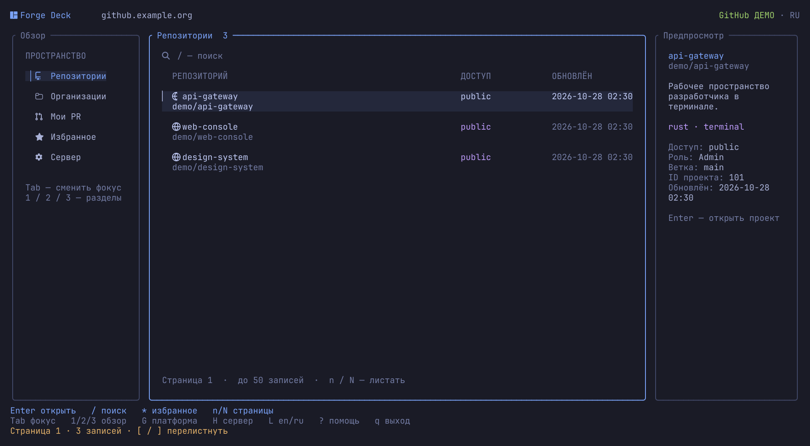
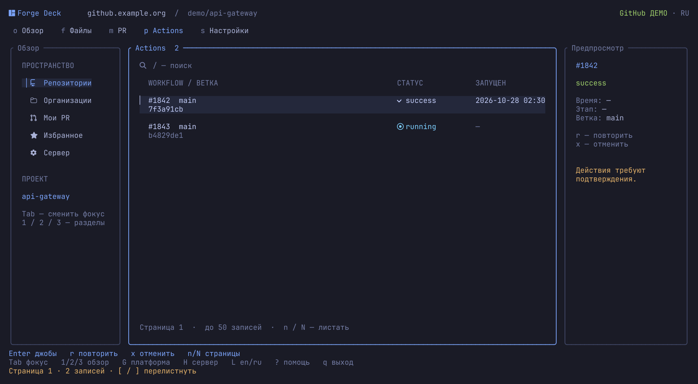
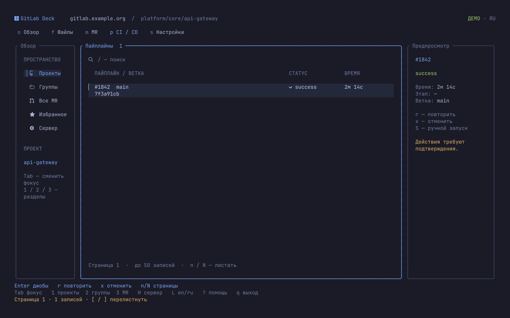
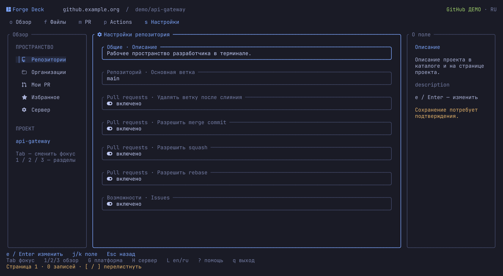

<div align="center">

# Forge Deck

[English](README.md) · **Русский**

### GitHub и GitLab в одном терминале.

Репозитории · pull и merge requests · Actions и пайплайны

[](https://github.com/IgorKramar/forge-deck/actions/workflows/ci.yml)
[](https://github.com/IgorKramar/forge-deck/releases/latest)
[](LICENSE)


[Установка](#установка) · [Запуск](#запуск) · [Язык](#язык-интерфейса) · [Клавиши](#клавиши) · [Ограничения](#возможности-и-ограничения)

</div>



**Найдите репозиторий, изучите изменения и откройте лог джобы — прямо в терминале.**
Forge Deck — самостоятельный TUI на Rust для GitHub, GitHub Enterprise, GitLab.com и собственных серверов GitLab. Локальный клон не нужен. Авторизация остаётся в привычных `gh` и `glab`.

Тема Tokyo Night, иконки Nerd Font, скруглённые панели, отступы и заметный фокус. **`G`** переключает платформу; адрес сервера и избранное сохраняются отдельно.

## Что внутри

| Раздел | GitHub | GitLab |
|:---|:---|:---|
| **Каталог** | Доступные репозитории, организации, поиск репозиториев | Проекты, группы, проекты группы, поиск |
| **Код** | Каталоги, текстовые файлы, ветки | Каталоги, текстовые файлы, ветки |
| **Ревью** | Открытые PR, описания, диффы файлов, общие комментарии; PR с вашим участием | Открытые MR, описания, диффы, комментарии; общий список MR |
| **CI** | Actions → джобы → логи; повтор запуска или джобы, отмена запуска | Пайплайны → джобы → логи; повтор, отмена, запуск ручных джоб |
| **Настройки** | Восемь полей репозитория, нужны права администратора | Пятнадцать полей проекта, нужна роль Maintainer/Owner |
| **Пространство** | Локальное избранное, страницы, EN/RU | Локальное избранное, страницы, EN/RU |

<details>
<summary><strong>Просмотр GitHub Actions</strong></summary>



`p` → выбрать запуск → `Enter` → выбрать джобу → `Enter` → читать лог.

Повтор джобы GitHub также перезапускает зависимые джобы. Отмена действует на весь workflow run; отдельную джобу отменить нельзя. Аналога ручных джоб GitLab здесь нет.

</details>

<details>
<summary><strong>GitLab под рукой</strong></summary>



Привычная навигация и действия GitLab. `G` возвращает к сохранённому подключению GitLab.

</details>

<details>
<summary><strong>Изменение настройки</strong></summary>



`e` → изменить одно поле → сверить старое и новое значения → подтвердить или нажать `Esc`.

</details>

*На скриншотах — демоданные, отрисованные самим приложением.*

## Установка

Нужны **Linux** и CLI используемой платформы: [GitHub CLI (`gh`)](https://cli.github.com/) и/или [GitLab CLI (`glab`)](https://docs.gitlab.com/cli/). Для `--demo` не нужны ни CLI, ни доступы.

### Готовый бинарник

В [Releases](https://github.com/IgorKramar/forge-deck/releases/latest) доступны архивы Linux для **x86_64** и **ARM64**, собранные на Ubuntu 22.04 с glibc. Они не предназначены для musl/Alpine. Rust для запуска не нужен.

```sh
version=0.3.0
target=x86_64-unknown-linux-gnu  # ARM64: aarch64-unknown-linux-gnu
archive="forge-deck-v$version-$target.tar.gz"
base="https://github.com/IgorKramar/forge-deck/releases/download/v$version"
curl --fail --location --remote-name "$base/$archive" --remote-name "$base/SHA256SUMS" &&
awk -v archive="$archive" '$2 == archive' SHA256SUMS | sha256sum --check - &&
tar -xzf "$archive" &&
install -Dm755 "forge-deck-v$version-$target/forge-deck" "$HOME/.local/bin/forge-deck" &&
install -Dm755 "forge-deck-v$version-$target/gitlab-deck" "$HOME/.local/bin/gitlab-deck"
```

Добавьте `~/.local/bin` в `PATH`. В архиве находятся обе команды, оба README, лицензия MIT, changelog, описания архитектурных решений, скриншоты и `BUILDINFO.json` с коммитом исходников и платформой.

### Сборка через Cargo

Нужны Git и актуальный стабильный Rust с поддержкой edition 2024.

```sh
cargo install --git https://github.com/IgorKramar/forge-deck --tag v0.3.0 --locked
```

Cargo установит `forge-deck` и совместимую команду `gitlab-deck`, обычно в `~/.cargo/bin`. Этот каталог должен быть в `PATH`.

<details>
<summary>Сборка из локального клона</summary>

```sh
git clone https://github.com/IgorKramar/forge-deck.git
cd forge-deck
cargo install --path . --locked
```

</details>

Для такого оформления используйте терминал с true color и [Nerd Font](https://www.nerdfonts.com/). Минимальный размер — **80 × 24**. В узком окне `Tab` переключает фокус на меню или предпросмотр.

## Запуск

### Попробовать без сети

```sh
forge-deck --demo --provider github --lang ru
forge-deck --demo --provider gitlab --lang ru
```

Деморежиму не нужны сеть и доступы; файл настроек остаётся неизменным. Изменения живут в памяти; переподключение или смена платформы сбрасывают демоданные.

### GitHub

```sh
gh auth login --hostname github.com
forge-deck --provider github
```

Для GitHub Enterprise укажите его адрес при входе и запуске:

```sh
gh auth login --hostname github.example.org
forge-deck --provider github --host github.example.org
```

### GitLab

```sh
glab auth login --hostname gitlab.example.org
forge-deck --provider gitlab --host gitlab.example.org
```

Для GitLab.com используйте `gitlab.com`. Если CLI уже авторизован, повторный вход не нужен.

Следующие запуски восстанавливают платформу и её сервер:

```sh
forge-deck
```

`G` переключает GitHub/GitLab, `H` меняет сервер текущей платформы. Проверить подключение без открытия TUI:

```sh
forge-deck --provider github --check
forge-deck --provider gitlab --check
```

### Обновление с GitLab Deck

В версии 0.3.0 проект переименован в **Forge Deck**. Команда `gitlab-deck` продолжает работать. Если нового файла настроек ещё нет, приложение прочитает настройки GitLab Deck, сохранив язык, адрес, избранное и неизвестные поля. Старый файл остаётся неизменным; обычный режим сохраняет настройки уже по новому пути.

## Язык интерфейса

```sh
forge-deck --lang en
forge-deck --lang ru
```

`L` переключает EN/RU, обновляет экран и сохраняет выбор в обычном режиме. В деморежиме настройки не записываются.

Приоритет: `--lang` → сохранённый язык → системная локаль → английский. Используется первое непустое значение `LC_ALL`, `LC_MESSAGES` или `LANG`: `ru` выбирает русский, остальные — английский.

Переводятся подписи приложения. Содержимое репозиториев, комментарии, диффы и логи сохраняют исходный текст. Демоданные используют язык, выбранный при запуске. Справка командной строки — на английском.

## Клавиши

| Клавиши | Действие |
|:---|:---|
| `j` / `k`, `↑` / `↓`, `PgUp` / `PgDn` | Выбор строки или прокрутка |
| `←` / `→` в тексте | Горизонтальная прокрутка |
| `Tab` / `Shift+Tab` | Фокус: меню / содержимое / предпросмотр |
| `Enter` / `Esc` | Открыть / назад |
| `1` / `2` / `3` | Репозитории / организации / PR с вашим участием в GitHub; проекты / группы / MR в GitLab |
| `o` / `f` / `b` | Обзор / файлы / ветки |
| `m` / `p` / `s` | PR или MR / CI / настройки |
| `d` / `c` внутри PR или MR | Дифф / комментарии |
| `/` | Поиск; точный фильтр по ветке для запусков CI |
| `[` / `]` | Предыдущая / следующая страница |
| `n` / `N` в тексте | Следующее / предыдущее совпадение |
| `*` | Добавить или убрать избранное |
| `R` / `F5` | Обновить текущий экран или лог |
| `r` / `x` | Повтор / отмена CI, где поддерживается |
| `S` | Запустить ручную джобу GitLab |
| `e` в настройках | Изменить поле; `←/→` выбирают значение, `Ctrl+U` очищает ввод |
| `G` / `H` | Сменить платформу / сервер |
| `L` | Переключить EN/RU |
| `?` / `q` | Справка / выход |

`q` сначала закрывает открытый диалог. `Ctrl+C` завершает приложение.

## Возможности и ограничения

**Изменения требуют подтверждения.** Для настройки показаны поле, старое и новое значения; для CI — репозиторий, объект и действие. За один запрос меняется только одно поле. Отсутствующие поля недоступны для редактирования. Итоговую проверку прав выполняет сервер.

<details>
<summary>Доступные настройки</summary>

**GitHub:** описание, основная ветка, удаление веток после слияния, merge commits, squash и rebase merging, issues и wiki. Нужны права администратора репозитория и соответствующие права токена.

**GitLab:** название проекта, описание, видимость, основная ветка, способ слияния, правило squash, требования успешного CI и закрытых обсуждений, удаление исходной ветки, уровни доступа к issues/MR/wiki/CI, общие раннеры и тайм-аут джобы.

</details>

**Списки разбиты на страницы по 50 записей.** Файлы, джобы и избранное фильтруются на текущей странице; организации и ветки GitHub — тоже. Поиск репозиториев GitHub ищет среди доступных репозиториев платформы, а не только загруженного каталога. Общий список PR использует `involves:вы`; это не список всех доступных PR.

**Действуют ограничения API GitHub.** Поиск отдаёт не более 1000 результатов. Каталоги делятся на страницы локально из ответа Contents, ограниченного 1000 элементами. Список файлов PR ограничен 3000 файлами; GitHub может не вернуть часть патчей. Экран комментариев показывает общую ленту PR, без inline-комментариев и результатов ревью. Логи джобы могут быть недоступны до её завершения. Обновление вручную: `R` / `F5`.

**Ответы ограничены 2 МиБ.** Слишком большой JSON отклоняется, сокращённый текст помечается. Бинарные файлы, подмодули и символические ссылки GitHub не открываются в предпросмотре. GitLab может дополнительно ограничивать диффы.

**Пока недоступны:** администрирование инстанса, управление организациями/группами/пользователями, изменение CI-секретов, отправка комментариев, слияние PR/MR. Адреса IPv6 не поддерживаются. Избранное GitHub разрешает числовые ID репозиториев через существующий, но недокументированный маршрут `repositories/{id}`.

## Доступы и локальные настройки

Авторизацией управляют `gh` и `glab`. Forge Deck не читает их файлы токенов, не создаёт хранилище доступов и не передаёт токены в аргументах процессов. Управляющие последовательности терминала удаляются из ответов перед отрисовкой.

Настройки хранятся здесь:

```text
$XDG_CONFIG_HOME/forge-deck/config.json
# или ~/.config/forge-deck/config.json
```

Старый `gitlab-deck/config.json` читается только при отсутствии нового. Приоритет платформы: `--provider` → сохранённая платформа → GitLab. Приоритет сервера: `--host` → сохранённый адрес этой платформы → `GH_HOST` / `GITLAB_HOST` → `github.com` / `gitlab.com`. Формат — `hostname[:port]`, без схемы и пути. Избранное разделено по платформе и серверу.

> Если соединение пропало во время изменения, результат может быть неизвестен. Приложение перечитает данные и сохранит предупреждение. Проверьте результат перед повтором: выход из TUI не отменяет уже отправленную операцию на сервере.

## Разработка

Интерфейс построен на [Ratatui](https://ratatui.rs/) и Crossterm, REST-транспорт — на `gh api` / `glab api`. Один фоновый обработчик выполняет запросы; отмена, тайм-ауты и номера поколений защищают от зависаний и устаревших ответов. Подробнее: [терминал и авторизация](docs/adr/0001-terminal-and-authentication.md), [интеграция GitHub](docs/adr/0002-multiple-forges.md).

```sh
cargo fmt --all -- --check
cargo clippy --locked --all-targets -- -D warnings
cargo test --locked
cargo build --release --locked
python3 tests/terminal_smoke.py target/release/forge-deck
python3 tests/provider_hosts.py target/release/forge-deck
python3 -m unittest discover -s tests -p test_release.py
```

Тесты используют демоданные и подставной CLI. Проверка PTY охватывает обе платформы и оба языка при трёх размерах терминала. Реальные репозитории при этих проверках не изменяются.

CI проверяет форматирование, Clippy, Rust-тесты, архивы и извлечённые бинарники на нативных Linux-раннерах x86_64 и ARM64. Пуш тега `v*` повторяет проверки, сверяет версию Cargo и коммит исходников, затем публикует оба архива и `SHA256SUMS`. Описания релизов находятся в `docs/releases/`; изменения — в [changelog](CHANGELOG.md).

При сбое публикации черновик остаётся для проверки. Изучите неудачный прогон и его черновик, удалите только этот неудачный черновик, сохранив Git-тег, затем повторите workflow; опубликованные релизы автоматически не перезаписываются.

Для pull request опишите изменение поведения, при необходимости обновите оба языка интерфейса и README, затем выполните проверки выше.

Нашли ошибку? [Создайте issue](https://github.com/IgorKramar/forge-deck/issues) с версией приложения, размером терминала и шагами воспроизведения. Не прикладывайте приватные адреса, содержимое репозиториев и токены.

## Лицензия

[MIT](LICENSE) · Copyright © 2026 Igor Kramar.

---

<div align="center">

**[Igor Kramar](https://github.com/IgorKramar)** · Rust · Tokyo Night

</div>
